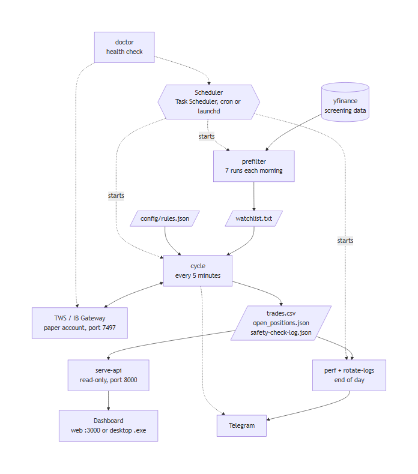
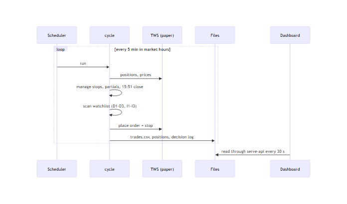

# trading-bot

<details open>
<summary> <b>Brief Review</b></summary>

An autonomous **paper-trading** bot for Interactive Brokers (IBKR), written in Python 3.14 and managed with `uv`. It trades the "Trend Join Long" strategy defined in `config/rules.json`: each morning it screens the S&P 500 for gappers, and every 5 minutes during market hours it checks the watchlist against six entry filters, sizes and places the trade, then manages the stop, the partial exit and the end-of-day close. A read-only dashboard (web or desktop) shows what the bot is doing, and Telegram carries the alerts and the daily summary.

The bot talks to TWS (or IB Gateway) on your own machine. It is meant for a **paper account only** until it has run cleanly for at least two weeks.

<p align="center">

</p>

**Strategy in one paragraph.** A stock is a candidate if it gapped up at least 3% at the open and trades above $3. It must then pass three daily filters (D1-D3) and three intraday filters (I1-I3). The bot enters with a stop, takes a partial at +0.75R, moves the stop to breakeven, trails it, and force-closes everything at 15:51 ET. Optional extra indicator filters (RSI, MACD) can be added in `rules.json`.

The project tree:

```
config/          strategy rules (rules.json)
docs/            development story and plans
logs/            runtime logs (gitignored)
src/trading_bot/
  broker/        TWS connection and order helpers
  cli/           thin command-line wrappers (buy-one, close-one, buy-stop)
  cycle/         the 5-minute trading cycle: filters, indicators, stops, decision log
  scanner/       S&P 500 gapper screening and the watchlist
  reporting/     daily summary and R-multiples
  maintenance/   log rotation, S&P 500 list refresh
  scheduling/    Task Scheduler (Windows), cron (Linux), launchd (macOS)
  doctor/        `uv run doctor`: setup health checks with a fix for each failure
  api/           read-only dashboard API (Starlette)
  bot.py         bot entry point (`uv run trading-bot`)
tests/
  unit/          fast, offline tests
  integration/   live tests against TWS (marked `live`)
frontend/        Next.js dashboard and Electron desktop app (own README)
```

</details>

<details open>
<summary> <b>Setup</b></summary>

**You need:** [uv](https://docs.astral.sh/uv/), Interactive Brokers TWS (or IB Gateway) with a **paper** account, and for the dashboard Node.js 20.9+. Telegram is optional.

### 1. Configure TWS

Log in to TWS with your paper account, then go to *File > Global Configuration > API > Settings* and set:

- tick **Enable ActiveX and Socket Clients**
- socket port **7497** (TWS paper)
- untick **Read-Only API**
- add **127.0.0.1** to *Trusted IPs*

IB Gateway works too: set `IBKR_PORT=4002` (paper) in `.env`.

| Application | Paper | Live |
|---|---|---|
| TWS | 7497 | 7496 |
| IB Gateway | 4002 | 4001 |

### 2. Install and configure the bot

```bash
uv sync                      # creates .venv with everything pinned in uv.lock
cp .env.example .env         # Windows PowerShell: Copy-Item .env.example .env
```

Edit `.env`. The defaults are fine for a first run; leave `PAPER_TRADING=true` and the port at 7497. Optional: `TELEGRAM_BOT_TOKEN` and `TELEGRAM_CHAT_ID` for alerts.

### 3. Check everything

```bash
uv run doctor                # 8 checks, a fix for anything wrong, places no order
uv run pytest                # unit tests only (offline)
```

`doctor` should end with `0 failed`. A warning about the schedule is expected until step 5.

</details>

<details open>
<summary> <b>Using the Trading Bot</b></summary>

### 4. Try it by hand first

```bash
uv run prefilter --dry-run                     # screen the S&P 500 for gappers, write nothing
uv run prefilter                               # same, and write watchlist.txt
uv run trading-bot --symbol NVDA --check-only  # connect, evaluate, print; never trades
uv run cycle                                   # one trading cycle (places paper orders in market hours)
```

Outside market hours `cycle` exits in about half a second and does nothing.

### 5. Let it run on its own

```bash
uv run setup-schedule        # registers 11 tasks (prefilters, the 5-minute cycle, summary, log rotation)
uv run schedule-status       # shows which are enabled
uv run disable-schedule      # pause everything   (enable-schedule resumes)
uv run cleanup-schedule      # remove every task and restore power settings
```

- Times are given in US Eastern and converted to your local time. **Re-run `setup-schedule` after daylight-saving changes** (March and November).
- TWS must be running and logged in for the cycle to trade. Tasks run only while you are logged in to the computer, and it must be awake.
- The same commands work on every system: Task Scheduler on Windows; cron on Linux (a marked block in your crontab, original saved to `schedule_crontab.backup`, output in `logs/cron.log`); launchd on macOS (LaunchAgents `com.tradingbot.HT_*.plist`, output in `logs/launchd.log`). Linux and macOS have no keep-awake job, so stop the machine sleeping yourself (`caffeinate -s` on macOS).

### 6. Start the dashboard

```bash
# Web app: two terminals
uv run serve-api                         # backend, http://127.0.0.1:8000 (read-only)
cd frontend && npm install && npm run dev   # UI at http://localhost:3000

# Desktop app: with the backend running (or let the app start it)
cd frontend && npm run desktop           # builds, then opens a window
cd frontend && npm run desktop:dist      # builds dist-desktop/TradingBot-<version>-portable.exe
```

The page refreshes every 30 seconds. It shows today's P&L, the equity curve, open positions with stop and target, the last cycle's entries and skip reasons, the trades table, and a "Paper trading" strip counting the days of your 14-day paper run. More in `frontend/README.md`. The exe is unsigned, so Windows SmartScreen may warn on first run.

<p align="center">

</p>

### Everyday commands

| Command | What it does |
|---|---|
| `uv run doctor` | Checks the whole setup and says how to fix each problem |
| `uv run perf [--no-notify]` | Daily summary from `trades.csv`, sent to Telegram (best after the close) |
| `uv run rotate-logs` | Archives old logs, keeps 90 days in `trades.csv` |
| `uv run scan [--loop]` | Intraday gapper rescan into the same watchlist |
| `uv run refresh-sp500` | Compares the S&P 500 list with Wikipedia (writes nothing; refresh every 2-3 months) |
| `uv run buy-one` / `close-one` | Buy or close 1 share of MU on paper |
| `uv run pytest -m live` | Live tests; they place real **paper** orders and need TWS running |

Files the bot writes: `trades.csv` (fills), `open_positions.json` (positions it manages), `safety-check-log.json` (every decision and skip reason), `watchlist.txt` (today's candidates), `logs/` (errors and rotation). All are gitignored and safe to ignore; `trades.csv` is the only one that is your history.

### Safety

- `PAPER_TRADING` must agree with `IBKR_PORT` (7497/4002 paper, 7496/4001 live) **and** with the account TWS is logged into. A mismatch aborts before any order. Paper accounts start with `D` (`DU1234567`).
- Paper trade for at least two weeks before even considering anything else.
- Backtested numbers do not transfer perfectly to live execution (limited tickers and timeframe, gap and halt risk, partial fills). Treat the bot as a starting point and iterate on `config/rules.json`.

### Adding an indicator filter

The six entry filters are fixed. Anything else goes in an optional `custom_filters` list in `config/rules.json`, with no code change:

```json
"custom_filters": [
  {"name": "X1_rsi", "indicator": "rsi", "source": "intraday",
   "params": {"period": 14}, "op": ">=", "value": 50},
  {"name": "X2_macd", "indicator": "macd_hist", "source": "daily",
   "params": {"fast": 12, "slow": 26, "signal": 9}, "op": ">", "value": 0}
]
```

`source` is `daily` or `intraday` (today's 5-minute closes); `op` is `>=`, `>`, `<=` or `<`. Too little history fails the filter, and a failed filter shows in the skip reasons by its `name`. A new indicator is a function decorated with `@indicator("name")` in `src/trading_bot/cycle/indicators.py` that takes a close-price Series and returns the latest value (or `None`). Try it on paper first.

### Telegram alerts

Set `TELEGRAM_BOT_TOKEN` and `TELEGRAM_CHAT_ID` in `.env` (optional `NOTIFY_URL` for ntfy). Failures never break trading and are logged to `logs/notify_errors.log`. Send a test with `uv run pytest -m live_notify tests/integration/test_live_notify.py`.

</details>

<details open>
<summary> <b>Troubleshooting</b></summary>

Run `uv run doctor` first. It checks in order and says what to fix:

| Symptom | What `doctor` reports | Fix |
|---|---|---|
| `Connected: False`, TWS is not running | `TWS port` FAIL, "not running" | Start TWS (or IB Gateway) and log in to the paper account. |
| Wrong API port | `TWS port` FAIL, "wrong API port ... port N is open" | Set `IBKR_PORT` (and `PAPER_TRADING`) to match; 7497 TWS paper, 4002 Gateway paper. |
| Trusted IPs missing, API access disabled | `API session` FAIL, "API did not answer" | Tick *Enable ActiveX and Socket Clients*, add `127.0.0.1` to *Trusted IPs*, accept any connection dialog. |
| Wrong account type | `Account` FAIL | Log in with a paper (`DU...`) account, or set `PAPER_TRADING` to match. |
| Missing market data subscription | `Market data` WARN | Paper accounts get free delayed US data; check Market Data Subscriptions. Normal on a weekend. |
| Orders rejected, trading permissions not enabled | `Order permission` FAIL | Enable US Stocks trading permission; untick *Read-Only API*. The check is a what-if order, so nothing is placed. |
| Scheduled tasks not running | `Schedule` and `Last cycle` WARN | `uv run setup-schedule` or `enable-schedule`. If the market is open and the last cycle is old: the machine is asleep, you are logged out, or Task Scheduler permissions (run the task by hand and read its Last Run Result). |
| Dashboard says "Couldn't load" | n/a | Start the backend: `uv run serve-api`. |

`doctor` exits 1 when any check fails and 0 otherwise (warnings do not fail it). It uses its own client id (90), so it can run while the bot is scheduled.

</details>

<details open>
<summary> <b>Results</b></summary>

The bot has completed its build and verification on a paper account: 796 Python tests, 288 frontend unit tests, and browser and desktop end-to-end tests pass. The two-week paper run is only starting, so there are no performance results to show yet. Track progress on the dashboard's "Paper trading" strip and in the daily Telegram summary.

How the project was built, step by step, is in [docs/development-story.md](docs/development-story.md).

</details>

<details open>
<summary> <b>Issues</b></summary>

- The Next.js dev-server badge overlaps the theme switch in development only.
- The desktop `.exe` is unsigned (SmartScreen may warn).
- The scheduler can briefly flash a black console window on Windows. The fix (running through `pythonw`) is planned and not built yet.
- The macOS launchd backend is covered by unit tests with a fake `launchctl` but has not been run on a real Mac.
- Yahoo data is for screening only and can be delayed or incomplete; IBKR handles execution.

</details>

<details open>
<summary> <b>Future Work</b></summary>

- :heavy_check_mark: Dashboard (web and desktop)
- :heavy_check_mark: Pluggable indicator filters (RSI, MACD)
- :heavy_check_mark: Setup health check (`doctor`) and paper-only account guard
- :x: Short selling
- :x: Strategy analysis report
- :x: Options and futures
- :x: Other brokers (would replace `src/trading_bot/broker/`)

Details and the order of work are in [docs/plans/future-development.md](docs/plans/future-development.md).

</details>

<details open>
<summary> <b>Contributing</b></summary>

Contributions are welcome. Fork, change, and open a pull request. Please follow the project's rules: tests first, paper account only, and a library only when a step really needs it.

</details>

<details open>
<summary> :iphone: <b>Having Problems?</b></summary>

Run `uv run doctor` and follow the fix it prints, then check the Troubleshooting table above. Errors are written to `logs/cycle_errors.log`.

</details>

<details open>
<summary> <b>License</b></summary>

No license has been chosen yet. Add a `LICENSE` file before sharing the code.

</details>
